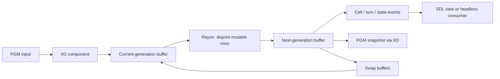

# Parallel Game of Life in Rust

**Concurrency, grid algorithms and event-driven simulation — Bristol coursework extension.**

A Rust implementation of Conway's Game of Life on a toroidal grid. It computes each
generation in parallel, displays cell changes through an optional SDL interface, and
writes PGM snapshots through a separate I/O component.

## Contribution and provenance

This project extends the University of Bristol's
[Game of Life Rust skeleton](https://github.com/UoB-CSA/gol-rs-skeleton).
The supplied framework, fixtures and custom test harnesses remain university work.

Aryan's commit history records the simulation and parallelisation work, including the
[worker-pool milestone](https://github.com/Aryan-R-A/gol-rs-aryan/commit/ae4edb4295df70f4f6d7f8a989a23331f7f8a905)
and [subsequent parallel implementation](https://github.com/Aryan-R-A/gol-rs-aryan/commit/316574c5aa60f53f8807d08ab258d77affe09470).
The active implementation is in [src/gol/distributor.rs](src/gol/distributor.rs);
it uses Rayon rather than the older commented scoped-thread alternative.

This is coursework-derived software. Keep the supplied attribution and confirm the
applicable course publication rules before making a private copy public.

## Architecture and algorithm



For every cell, count eight wrapped neighbours. A live cell survives with two or three
live neighbours; a dead cell becomes live with three. Each update reads only the
current buffer and writes a disjoint row of the next buffer, then swaps the two.

The update costs **O(width × height)** per generation and uses two grid buffers.
Additional work scans changed cells and counts live cells for events and statistics.
Channels coordinate I/O, key presses and rendering; a separate ticker reports the
latest completed generation through shared statistics.

### Engineering trade-offs

- Double buffering preserves generation boundaries without a mutex per cell.
- Row partitioning gives Rayon non-overlapping writes; it still reads neighbouring rows.
- Event generation and population counts add sequential work beyond the parallel update.
- Interactive execution includes I/O and event consumption; the benchmark omits SDL
  and file I/O, but still includes event/statistics work.

## Run

Use a Rust toolchain supporting **edition 2024** and the SDL2 development library.
The audit build used Rust **1.91.1** and SDL2 **2.30.0** in Linux/WSL.

On Debian/Ubuntu:

```bash
sudo apt-get update
sudo apt-get install build-essential pkg-config libsdl2-dev
git clone git@github.com:Aryan-R-A/gol-rs-aryan.git
cd gol-rs-aryan
cargo check --all-targets
cargo run --release -- --width 512 --height 512 --turns 100 --headless
```

Run from the repository root: input is `images/<width>x<height>.pgm` and snapshots
are written under `out/`. Use a size with a supplied input image (16, 64, 128, 256 or
512 square), or provide an image with matching dimensions.

Omit `--headless` for the SDL window. **P** pauses/resumes, **S** writes a snapshot,
and **Q** quits. `cargo run -- --help` lists the CLI options.

**Thread-count caveat:** the current runtime accepts `--threads`, but its active
Rayon update does not bind a pool to that argument. Use `RAYON_NUM_THREADS` to
control the Rayon pool for a process:

```bash
RAYON_NUM_THREADS=8 cargo run --release -- --width 512 --height 512 --turns 100 --headless
```

The existing tests vary the CLI argument; this alone does **not** establish that the
runtime actually used each requested worker count.

## Tests

The repository uses custom executable test harnesses (`harness = false`), not just
ordinary Rust `#[test]` functions.

```bash
RAYON_NUM_THREADS=2 cargo test --test gol -- -t 2
RAYON_NUM_THREADS=2 cargo test --test pgm -- -t 2
RAYON_NUM_THREADS=2 cargo test --test count
RAYON_NUM_THREADS=2 cargo test --test sdl
```

- `gol`: compares generations with supplied reference boards.
- `pgm`: verifies saved images against those reference boards.
- `count`: checks population-reporting events.
- `sdl`: checks interaction/state behaviour in headless mode by default; its `--sdl`
  flag requires a working display.

Inspect the harnesses in [tests/](tests/) for their exact workload and options.
These checks are not proof of exhaustive race freedom or correct worker-pool sizing.

## Benchmarks and evidence

```bash
cargo bench --bench bench
```

[benches/bench.rs](benches/bench.rs) uses Criterion, a **512 × 512** world and
**1,000 generations**, with dedicated Rayon pools of **1, 2, 4, 8 and 16 threads**.

The helper seeds one live cell, which dies immediately. It therefore measures mostly
a dead-world workload, including event/statistics overhead, rather than a representative
evolving population. Pool construction is outside the timed iteration.

Aryan's CV reports **4.41 s → 0.99 s with eight threads** (approximately **4.45×**).
The original report, machine specification and exact revision were not established by
this audit, so that result is **historical and unverified**, not a reproducible headline.
Untracked local Criterion output is not substituted for the missing original evidence.

For a publishable comparison, retain the commit, lockfile, Rust version, CPU, operating
system, build profile, initial board, thread count, repeated measurements and variability.
State separately whether each number measures only simulation or the complete application.

## Limitations and next steps

- Bind and validate the runtime worker count, then test the actual pool size.
- Benchmark a deterministic nontrivial population alongside the current workload.
- Review ticker lifecycle and explicit shutdown across repeated simulations.
- Validate dimensions, multiplication overflow and turn-count conversion.
- Add automated checks and a committed lockfile for reproducible application builds.
- A tracked file named `src/gol/distributor.rs:32:9` is a stray empty artefact;
  review its removal separately rather than silently deleting evidence.

[Coursework guide](https://uob-csa.github.io/gol-docs/rust/overview)
